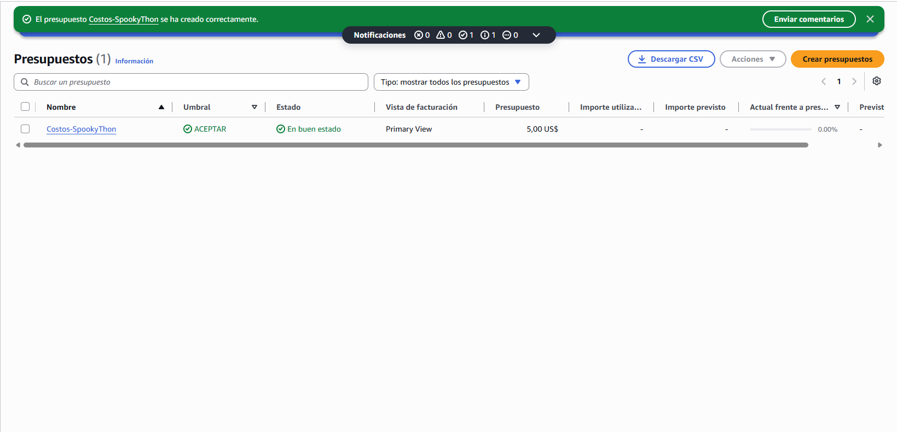

# Apocalipsis Manta — Simulador de Supervivencia Urbana

## ¿Qué es?
Plataforma de simulación de evacuación urbana sobre el grafo vial real de **Manta, Ecuador** (OpenStreetMap). Con recálculo dinámico ante colapsos viales, predicción de zombies corredores y balanceo de carga en refugios.

## ¿Para qué sirve?
Nos ayuda entender como funcionas algoritmos de diversas aplicaciones que se usan en el día a día, como el GPS o las aplicaciones de delivery.

---

## Links de Entrega
- **Web Desplegada:** https://beyond-null-alternate-integral.trycloudflare.com/inicio.html
- **Documentación Interactiva API:** https://beyond-null-alternate-integral.trycloudflare.com/docs
- **Región de AWS utilizada:** `us-east-1` (N. Virginia)

---

## Información Técnica

### Herramientas utilizadas
- Python 3.12.10
- HTML
- fastapi
- uvicorn
- pydantic
- osmnx (sirve para descargar, modelar, analizar y visualizar redes de calles y datos geoespaciales desde OSM)
- networkx (sirve para crear, manipular, analizar y visualizar redes complejas y teorías de grafos)

### Estructura del proyecto
```
├─ Apocalipsis-Manta-main/
   │
   ├── API/
   │   │
   │   ├── Elementos/
   │   │   │
   │   │   ├── Mapa Manta/
   │   │   │   ├── Obtener Mapa Grafo.py
   │   │   │   │   └─ Devuelve grafo (.graphml) de las calles de Manta
   │   │   │   │
   │   │   │   └── Reducir Grafo.py
   │   │   │       └─ Reduce el grafo a una zona aleatoria sin romper nodos.
   │   │   │
   │   │   ├── Grafo.py/
   │   │   │   └── Funciona como modulo. Carga el grafo reducido de manta y obtiene las coordenadas de los nodos, conecciones y costos de recorrido, y la velocidad maxima (valor que sirve como euristica)
   │   │   │
   │   │   ├── Clases.py/
   │   │   │   └── Funciona como modulo. Clases de las entidades (Zombie, Sobreviviente y Refugio)
   │   │   │
   │   │   ├── AlgoritmoBusqueda.py/
   │   │   │   └── Funciona como modulo. Funciones relacionadas al algoritmo de busqueda A* (algoritmo_busqueda, nodos_a_distancia_k, calcular_zonas_peligro, obtener_aristas_contraflujo_zombies)
   │   │   │
   │   │   ├── FuncionesSimulador.py/
   │   │   │   └── Funciona como modulo principal. Crea la clase "EstadoMundo" entre otras funciones utiles para el comportamiento de las entidades en el simulador.
   │   │   │  
   │   │   └── mapa_manta_300.graphml/
   │   │       └── Grafo reducido de Manta
   │   │     
   │   └── Web
   │       │
   │       ├── imagenes/
   │       │   └── Imagenes de las entidades, se usan para mejorar la interfas HTML.
   │       │
   │       ├── api.py/
   │       │   └── Api de la aplicacion.
   │       │       └─ Recibe agunas funciones de los modulos de la carpeta "Elementos", define los ENDPOINTS y configura las RONDAS por defecto.
   │       │
   │       ├── mapa.html/
   │       │   └── Crea el mapa en HTML usando los Endopoints de la API
   │       │
   │       └── inicio.html/
   │           └── Mejora la interfaz grafica (Es el archivo principal de interfaz).
   │        
   └── requeriments.txt/
        └── Requerimeintos de la aplicación
```   

## Endpoints
---
Autenticación requerida en todos los endpoints mediante la cabecera:
`x-api-key: clave-desarrollo-local` 
*(Clave configurada por defecto para la evaluación del jurado en el entorno en vivo).*

| Método | Endpoint | Descripción |
| :--- | :--- | :--- |
| `POST` | `/paso` |  Recibe `{"sobrevivienteId": "S-0089", "nodoActual": "N-0117", "turno": 142}` y responde `{"siguienteNodo": "N-0118"}`|
| `GET` | `/estado` | Devuelve turno, métricas (activos, rescatados, mordidos, latencia p95), posiciones de zombies visibles, sobrevivientes con rutas, refugios y `aristasBloqueadas`. |
| `POST` | `/iniciar/{ronda}` | Inicializa las rondas oficiales de la Prueba de Fuego (`1`: Anochecer, `2`: Medianoche, `3`: Apocalipsis). |
| `POST` | `/avanzar` | Ejecuta un turno completo (Eventos → Zombies → Sobrevivientes → Mordidas → Refugios) y retorna el estado actualizado. |
| `POST` | `/simulacion-personalizada` | Permite al jurado calibrar en vivo la cantidad de sobrevivientes, zombies por tipo, semilla y turno/tipo de colapso vial. |
| `GET` | `/grafo` | Entrega la geometría vial clasificada para el renderizado en Leaflet.js. |

---

## Herramientas de AWS utilizadas

### Región de AWS utilizada: 
- us-east-1 (N. Virginia)

### Servicio utilizado
- 1 instancia Amazon EC2 t3.micro (2 vCPUs, 1 GB RAM, 8 GB EBS gp3) en la región us-east-1.
### Costos y presupuestos
- Costo por hora: USD $0.0104 / hora (cubierto al 100 % por los créditos del Free Tier de AWS).
- Costo total acumulado durante el reto: USD 0.00 (Consumo bruto estimado < USD $0.50).

### Captura de AWS Budgets (Alerta configurada desde el Día 1)


---

### Ejecución Local
#### 1. Clonar o descargar el repositorio
#### 2. Crear entorno virtual e instalar dependencias con requeriments
#### 3. Configurar API Key y levantar el servidor

## Autores
Manuel Elias Orellana Lavayen y Dherian Mikael Orellana Lavayen
